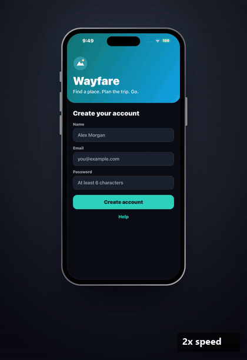
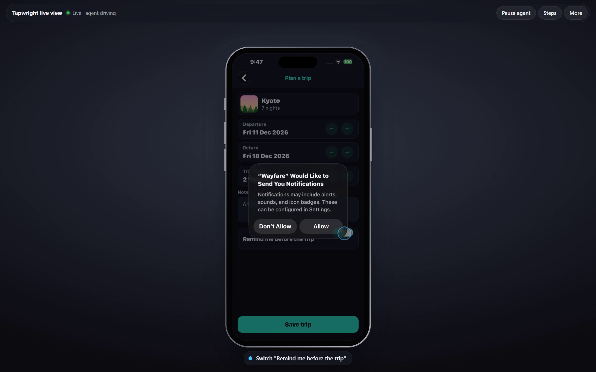

# Tapwright

**Real iPhone control for AI agents: QA, research and mobile workflows. From Windows, Linux or macOS.**

Tapwright gives an agent (Claude, Codex, anything that speaks MCP) eyes and hands on your
iPhone: it sees the screen as a list of elements plus a screenshot, and taps, types,
scrolls, swipes, answers permission prompts and opens deep links. It works with any app
on the phone: your TestFlight builds, development builds, the App Store version.
Nothing is added to your app, and no Mac or Xcode is needed.

<p align="center">
  
</p>
<p align="center"><sub>A Claude agent given one sentence ("test sign-up and a first trip the way a new user would") on a real
iPhone, through Tapwright. It finds the planted bug (the app accepts "abc" as an email) and answers iOS's own
permission prompt. Real time, with the agent's thinking pauses shortened;
<a href="https://github.com/bo5amis/tapwright/blob/main/docs/media/hero-landscape.mp4">with the live view around it</a>.</sub></p>

> [!NOTE]
> Connect a real iPhone over USB or the same Wi-Fi. Hardware measurements so far use
> one phone (an iPhone 14 Pro Max on iOS 26) from
> one Windows PC; see [Status](#status).

## How it works

```
 your computer                                              your iPhone
 ┌───────────────────────────┐   developer tunnel           ┌──────────────────────────┐
 │ agent ── MCP ── tapwright │  (USB, Wi-Fi, or any address │ WebDriverAgent           │
 │                           │   that reaches the phone)    │ (Apple's UI automation)  │
 │   pymobiledevice3 ────────┼─────────────────────────────▶│   taps, types, reads the │
 └───────────────────────────┘                              │   screen of any app      │
                                                            └──────────────────────────┘
```

Apple's UI-testing framework (XCTest) can drive any app on a phone in Developer Mode, as
long as a computer holds a developer connection to it. Tapwright runs
[WebDriverAgent](https://github.com/appium/WebDriverAgent) (the XCTest runner behind
Appium) on your phone, signed with your developer identity, and talks to it through
[pymobiledevice3](https://github.com/doronz88/pymobiledevice3)'s tunnel. That tunnel needs
no admin rights and works on any OS.

Tapwright drives **the whole phone from the outside** (any app, system alerts, the home
screen). Its sibling project [Tapline](https://github.com/bo5amis/tapline) drives **your own
React Native app from the inside**, through a small SDK in the app.

## You need

- An iPhone on iOS 17 or later, and a USB cable for the one-time setup.
- A computer with Python 3.10+. On Windows, install **Apple Devices** from the Microsoft
  Store (it provides the USB connection); on Linux, `usbmuxd`.
- An Apple Developer Program membership, for an App Store Connect API key (setup then
  creates the certificate and profile itself). Or bring your own Apple Development
  certificate (.p12) and a development profile for a wildcard App ID that includes the
  phone.

## Quick start

```sh
pip install tapwright
```

**One-time setup**, phone plugged in and unlocked:

```sh
tapwright setup --asc-key-id KEY_ID --asc-issuer-id ISSUER_ID --asc-key-file AuthKey_KEY_ID.p8 \
               --bundle-prefix com.yourname.tapwright
```

It pairs with the phone (tap **Trust**), checks Developer Mode, creates a development
certificate and profile through the API (the private key stays on your computer), signs
and installs WebDriverAgent, and pairs for network use. Details and the manual option:
[docs/setup.md](https://github.com/bo5amis/tapwright/blob/main/docs/setup.md).

**Try it** on one of your apps:

```sh
tapwright smoke --app com.yourcompany.yourapp
```

It opens the app, prints its first screen as elements, saves a screenshot, and closes it.

Run setup again any time: it skips what is done and ends with the next two commands. To keep
it working, `tapwright doctor` warns 30 days before the signing runs out, and
`tapwright doctor --fix` (phone on USB) repairs what it can.

**Give it to your agent.** One command registers the MCP server and installs its guidance:

```sh
tapwright install --client claude  # or codex / cursor
```

For a manual Claude Code registration:

```sh
claude mcp add tapwright -- tapwright mcp
```

Tapwright 1.7.5 provides whole-phone control by default. Apps, Home, Settings, system alerts and cross-app workflows are available. Permission judgment belongs to the agent and the user's instructions. Existing `--apps`, `--dedicated`, `--policy` and `--no-policy` options are compatibility inputs, not access restrictions. See the [1.7.5 migration contract](docs/agent-directed-control.md).

Other MCP clients: register `tapwright mcp` (stdio). Then ask, for example: *"Open MyApp
on my phone, sign up with a test email, and tell me if anything looks broken."*
[AGENTS.md](https://github.com/bo5amis/tapwright/blob/main/AGENTS.md) is the agent's guide; point your agent at it.
[docs/quickstart.md](https://github.com/bo5amis/tapwright/blob/main/docs/quickstart.md) walks through a first test.

**The skill** (`install` already did this; the command is for the skill alone). It teaches an agent how to test with Tapwright: the loop, how
to read an answer, what to do on each error, how to report, and the mistakes agents make.

```sh
tapwright skill install               # for you: ~/.claude/skills and ~/.agents/skills
tapwright skill install --project .   # for one project
```

**Starter routes** for the phone's own apps (Notes today; Reminders, Calendar, Mail and Messages follow). `tapwright starters install [--maps DIR]` adds them to your maps for `drive {"route": ...}`; a route or place of yours is never overwritten, and the answer names the routes it kept.

Claude Code reads `.claude/skills`; Codex and other agents read `.agents/skills`. The skill
is [skills/tapwright](https://github.com/bo5amis/tapwright/blob/main/skills/tapwright/SKILL.md), in the open
[Agent Skills](https://agentskills.io) format, so skill installers can take it from this
repository too.

## Tools

| Tool | What it does |
|---|---|
| `apps`, `open_app`, `close_app` | the apps you installed (TestFlight and development builds included); open one by bundle id or name, or close it; `open_app` can open it in another `language`, `region` or `text_size` (for that launch only, nothing in Settings changes); with those arguments the app is closed first, so a launch that fails leaves it closed |
| `look` | the screen: every visible element (role, text, id, position in points, what you can do with it) and a screenshot; `ocr: true` also reads the text in the picture that no element carries (games, canvases, web views), as refs `o1`, `o2` a touch can take (`pip install "tapwright[ocr]"`, about 300 MB, runs on the computer's CPU, about 1.5 s) |
| `tap`, `long_press`, `toggle` | by element `{id}` (`testID`/accessibility identifier), `{label}`, `{text}`, `{ref}` from the last list, or `{x, y}` |
| `type_text` | into a field (clearing it first by default, or pressing return after) |
| `scroll`, `swipe`, `back` | lists and pages, to the start, the end, or straight to an element; drags between points; up one screen (an open sheet closes first) |
| `wait`, `wait_for` | a fixed delay, or until some text, id or label shows up or goes |
| `alert` | accept, dismiss or read permitted alerts; `action: "cancel"` explicitly presses a verified Cancel button to recover from a system obstruction when the owner requests it, without showing private alert content |
| `press_button` | home, volume |
| `rotate` | turn the phone to portrait or either landscape side, to test an app's landscape layout |
| `network` | make the whole phone's network `offline`, `3g` or `lossy` (Apple's developer network conditions) to see an app's errors and loading states, or `normal` to restore it; every answer says the condition while it is on, and it ends with the session (or after 10 minutes without a call from the agent that set it, or 30 minutes at most). Over Wi-Fi only `3g` and `normal` (the other two would cut Tapwright's own link) |
| `open_url` | deep links |
| `viewer` | opens the live view in a browser on this computer, for you (the agent never gets the link: its key could approve a held-back touch) |
| `run` | several steps in one call, each with an optional check (`"expect": {"text": "Saved"}`); stops at the first that fails and answers once. A step may carry `if` (run it only when that is on screen) and `optional` (skip it when its own target isn't there), so one call covers a flow with a maybe-screen in it |
| `record`, `replay` | save what the agent does as a script, and run it again; `tapwright replay FILE` runs it in CI with no agent (exit code, `--junit`). `record` with `route: "<name>"` saves a route for `drive` instead: it starts from a named place, and a `type_text` with `as` is saved as a variable |
| `logs`, `crash` | the app's own log (level, grep, since) and its crash reports, read from the phone; a failed `run` step adds the log lines from that step, and a call the app crashed in ends with a note |
| `audit` | an accessibility check of the screen, by Apple's own XCTest audit: low contrast, tap targets under 44x44 pt, missing labels, clipped text, text that doesn't scale, wrong traits, duplicate ids; each issue names the element and the fix |
| `performance` | memory, CPU and frame rate of the app's own process while it waits, around a tap, or from a cold start to the first settled screen (`launch`); `run` and scripts can hold it to limits with `expect.under` |
| `ux_check` | one screen against the usability basics, as measured facts first (each names its element and its basis): too many competing choices, no one clear main action, the main action out of thumb reach, icon-only buttons with no label, cut-off text, low contrast and small targets (from `audit`), the same action named differently on screens you saw earlier, an error or empty state that doesn't say what to do next. Your house rules (`tapwright mcp --ux-rules FILE`: text rules you judge, `{"max_taps_to_goal": 4}` and `{"way_back": true}` the tool checks) are included |
| `media` | puts test pictures (jpeg, png, heic, up to 20 MB each) in the phone's photo library for an app's photo picker: `add` with their paths (`confirm` is a compatibility argument); `remove: true` deletes only what it added. Needs the runner with the photo routes (iOS asks you once to let it add photos, and once more, with a confirmation for each delete, to remove them) |
| `session_report` | where this session's calls went (the same from the shell: `tapwright report [--since TIME] [--client ID]`): calls per tool, failures by code, and waste to cut, each with its call numbers: looks right after an answer that had the changes, retries after `not_found`, scroll hunts, runs of actions that could have been one `run`; and the seconds, not only the calls: the agent's thinking time between calls, the tool's own time, by tool, and a line when calls came one process each (load the MCP server once) |
| `drive` | go to a place the map knows (`to`), or run a saved route (`route`), at the tool's own speed: a link when the place has one, else the shortest chain of proven roads, each move through the same execution queue as a single call. `with` fills a link's params, `then` adds `run` steps after arriving, `by` is `any`, `taps` or `link`, `dry_run` says the way, `account` names a test account (`--accounts FILE`: the tool types its username and password, the agent never sees them). One answer: `Arrived at language by 3 taps in 1.9 s (settings > general > language).` A road whose target is missing is repaired by another name or the only closest match, then planned again from a known place (twice at most), else `off_route`: nothing more is touched |
| `map` | the app's map, learned as you drive: the places Tapwright recognised, the roads (moves) between them, saved routes and reflexes, one line each, and where the app is now; `to` shows the shortest known way to a place and whether each road is proven on this build, `name` names the current place, `link` adds the link that reaches a place, `reflex` / `forget_reflex` and `forget` edit it. The file is `~/.tapwright/maps/<bundle id>/map.json` (`--maps DIR` on `serve`, `mcp` and `call` keeps it with a project); list-row text, typed text and secure values are never in it, and a navigation title only as a hash |
| `compare_screen` | visual regression: the first call saves the screen as a reference picture, later calls answer `Matches` or `Differs` with where it changed and a picture with the changes in red; `threshold` and `ignore` (a clock, an ad) tune it, and the status bar is never compared |
| `filmstrip` | several frames from the live stream in one numbered picture, for animations and loading states; `tap` first taps and films what it sets off |
| `notifications` | notifications from the whole phone's Notification Center, newest first, at most 20; `open: n` opens one. Notification Center is on the phone's screen for about a second while it is read; one-time codes are hidden |
| `journey` | test a feature as a real user would: `start: true` with a `goal` (and a `persona`, `conditions`) shows the screen in a user's eyes (no ids, nothing off screen, no jump-scrolling), measures taps, time, wrong turns and hesitations, and `stress` tries leaving the app, a bad network, a double tap, rotating and relaunching; `stop: true` with `reached` writes a report folder under `~/.tapwright/reports/` (Markdown, HTML, screenshots, filmstrip, a GIF) and `export` puts it in a GitHub PR or issue through `gh`, only when you ask |

Every action answers with what changed on the screen, not the whole list, and says how long the
screen took to settle. Add `screenshot: true` for a picture. `tapwright mcp --screenshots DIR`
saves the pictures as files instead of sending them. Errors are `Error <code>: <message>`; for
`not_actionable` the first word says why (`disabled`, `off_screen`, `covered`, `under_tab_bar`,
`behind_alert`, `no_action`). The tools and their errors are the same as Tapline's:
[docs/AGENT-TOOLS.md](https://github.com/bo5amis/tapwright/blob/main/docs/AGENT-TOOLS.md).

**From an agent's session to a test you keep.** An agent that knows a flow runs it as one `run`, each
step with the check that proves it worked:

```json
{"steps": [
  {"tool": "type_text", "target": {"id": "email"}, "text": "test@example.com"},
  {"tool": "tap", "target": {"id": "signup"}, "expect": {"id": "explore-greeting"}}
]}
```

With `record`, actions are saved in the same format. `tapwright replay sign-up.json --junit out.xml` runs the file again without an agent. Review scripts before executing them: app and policy flags do not limit their device access.

**Checks of how it looks, too.** `"expect": {"matches": "trip-saved"}` on a step (or a `compare_screen`
step) holds when the screen matches the reference picture of that name. `record` keeps the pictures next to the
script, in `sign-up.references/`, so they travel together. After an intended design change, `tapwright replay
sign-up.json --update-references` saves the new look; a failed check writes its picture
with the changes in red to `sign-up.diff/`. Reference pictures and those two folders are written whole or not at
all, and never through a link; on Windows that narrows, but can't close, the window for a folder that another process
of the same user swaps at that very moment. With `--screenshots DIR`, filmstrips and the difference picture an agent
gets back are saved to that folder by the ordinary screenshot writer, outside this guarantee.

**Driving fast.** Tapwright learns an app as an agent uses it: each screen it recognises is a place, each
move between places a road, kept in one map file per app (`~/.tapwright/maps`, or `--maps DIR` to keep it with
your project, shared with Tapline). On ground the map knows, `drive` goes to a place in one call and no model is
asked anything. On new ground, `tapwright install` also writes a driver agent, `phone-driver`: a subagent on your
agent's fastest small model (Claude Code: `.claude/agents/phone-driver.md` on Haiku; Codex:
`.codex/agents/phone-driver.toml`; `--driver-model NAME` changes it) that sends several moves in one call and saves
what it learns. No model runs inside Tapwright and no API key is asked for. Test accounts stay on your computer
(`--accounts FILE`): the agent says `tester2`, the tool types the password, and no answer, log or map holds it.
`brief: true` (or `tapwright mcp --brief`) shortens answers; `tapwright call look` makes a call without an
MCP connection, to the running `tapwright serve` (whole-phone control by default); and a
person's OK can be given in your chat, through the host's dialog, as well as in the live view (`--no-dialog` turns
that off).

## Live view

`tapwright serve` is a small background process that owns the connection to the phone.
Agent tools, the live view in your browser and any other client go through it, so you and
an agent can share one phone. Agent tools start it by themselves. To watch:

```sh
tapwright view      # opens the live view in your browser
```

<p align="center"></p>

You see the phone's screen live and can drive it: click to tap, hold to long-press, drag to
swipe, use the mouse wheel to scroll, and type into the focused field. Each step, the
agent's or yours, shows in plain words under the phone (`Tap "Save trip"`), and **Steps**
lists them. A step that couldn't be done shows in red with the reason (`Tap "Save" – covered`). The bar has **Pause agent**; **More** holds Home, volume, the picture quality and
**Details** (the element names and boxes, for when you're debugging). Your input goes first:
the agent waits while you drive. The live view is reachable from this computer only, with an
access token in the link.

- Drags play on the phone after you let go: WebDriverAgent can't follow a finger live.
- The picture is a stream of JPEG frames, about 28 a second while the screen changes and 5
  while it is still.
- `tapwright serve --video` plays the phone's own video instead, 60 frames a second, with
  nothing installed on the phone. The phone and the computer must be on the same Wi-Fi, and
  the computer needs an AirPlay receiver: see [docs/setup.md](https://github.com/bo5amis/tapwright/blob/main/docs/setup.md).
- The volume buttons press the phone's real buttons.

Other tools can use the same daemon: the agent tools over HTTP (`POST /api/<tool>`), and the
live view protocol in [docs/VIEWER-PROTOCOL.md](https://github.com/bo5amis/tapwright/blob/main/docs/VIEWER-PROTOCOL.md).

## Without the cable

After setup, unplug: on the same Wi-Fi, Tapwright finds the phone by itself, or give its
address with `tapwright serve --address 192.168.x.y`. Over Wi-Fi every step is slower than
over USB (see [Status](#status)); for long unattended runs, keep the cable in.

Reaching the phone from another network (a VPN such as Tailscale, or cellular) is not part
of version 1. `tapwright probe --host <address> --watch` exists to try it; treat it as
experimental.

## Agent judgment and user control

Tapwright provides device capabilities without app allowlists, label-based confirmations or grants. The agent follows your task and existing authorization. It should clarify consequential work outside that scope, without asking permission for each item in an authorized bulk operation. QA, competitor research, mobile social workflows and personal cleanup use the same tools.

Authentication and host checks protect the local control service. Keep its key private. Pause in the live view stops agent input; human input takes priority. Fresh targets, clear errors, dry-run and result verification remain part of reliable automation. `dry_run: true` on supported actions sends no input.

A delivered tap is not proof the app completed the intended action. Read the response and inspect the screen when needed. On timeout, check whether it happened before repeating it.

Actions are logged in `~/.tapwright/log/actions-<date>.jsonl`. Typed text is not logged; stored credentials remain redacted from routine logs and recordings. `tapwright serve --no-log` disables the action log.

## Limits

- Apple's automation sees what accessibility sees. Give important views accessibility
  identifiers (`testID` in React Native) and labels. Games and custom-drawn screens show
  little beyond their screenshot; `look` with `ocr: true` reads their text from the picture.
- Face ID, Touch ID and the passcode can't be automated; unlock the phone yourself.
- Before it lets a UI test start, iOS may ask for the passcode ("Enable UI Automation").
  Tapwright waits and tells the agent. Turn on Settings > Developer > Enable UI Automation
  on a test device, or an unattended run stops there.
- Whole-phone access does not override Apple's signing, pairing, trust or XCTest passcode requirements.
- System UI may be missing from accessibility. Use a fresh screenshot and coordinates when needed; verify the result.

## Status

| | |
|---|---|
| Works on our phone | setup from Windows; USB and Wi-Fi; every tool; the live view as JPEG frames and as video; app navigation; landscape, on both sides |
| Measured over USB | a tap, with its answer: 0.65 s; a look: 0.14 s; a toggle 0.66 s; typing 0.73 s; a scroll 1.46 s; a person's tap in the live view shows after 0.23 s; the reliability suite with no misses |
| Measured over Wi-Fi | slower: a tap 1.0 s, a look 0.4 s, typing 1.3 s; the reliability suite with no misses |
| Agents | a first-time agent with the skill tested the whole lab charter in 44 calls (40 with Tapline connected too) |
| Not done | over Wi-Fi, a tap (1.03 s) and typing (1.33 s) within Wi-Fi's own bar of 1.0 s (the toggle meets it), and a scroll within 1.5 s; a second phone or an iPad; a run by anyone but the authors |

Every number, how it was measured and how to run it yourself: [docs/benchmarks.md](https://github.com/bo5amis/tapwright/blob/main/docs/benchmarks.md).
The bar they are held against: [docs/QUALITY-BAR.md](https://github.com/bo5amis/tapwright/blob/main/docs/QUALITY-BAR.md).

## License

MIT. WebDriverAgent (BSD) and rcodesign (MPL-2.0) are downloaded at setup, not included. The runner is
Tapwright's build of Appium's WebDriverAgent 16.15.3 with a faster tap and drag ([bo5amis/WebDriverAgent](https://github.com/bo5amis/WebDriverAgent),
built by GitHub Actions, checked by its SHA-256); `TAPWRIGHT_WDA=appium tapwright setup --force` installs Appium's own.
Tapwright is not affiliated with Microsoft's Playwright or with Apple.
