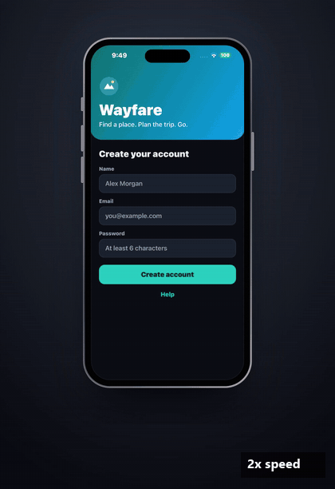
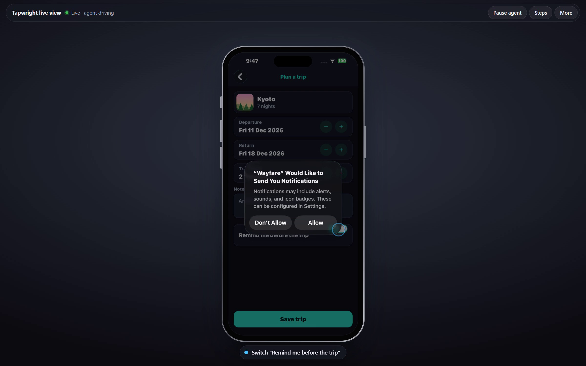

# Tapwright

**Playwright-style testing on your real iPhone, driven by AI agents. From Windows, Linux or macOS.**

Tapwright gives an agent (Claude, Codex, anything that speaks MCP) eyes and hands on your
iPhone: it sees the screen as a list of elements plus a screenshot, and taps, types,
scrolls, swipes, answers permission prompts and opens deep links. It works with any app
on the phone: your TestFlight builds, development builds, the App Store version.
Nothing is added to your app, and no Mac or Xcode is needed.

<p align="center">
  
</p>
<p align="center"><sub>A Claude agent given one sentence ("test sign-up and a first trip the way a new user would") on a real
iPhone, through Tapwright. It finds the planted bug (the app accepts "abc" as an email) and answers iOS's own
permission prompt. Real time, with the agent's thinking pauses shortened;
<a href="https://github.com/bo5amis/tapwright/blob/main/docs/media/hero-landscape.mp4">with the live view around it</a>.</sub></p>

> [!NOTE]
> Version 1 is for testing and QA on a **test phone that sits next to your computer**, over
> USB or the same Wi-Fi. It is measured on one phone (an iPhone 14 Pro Max on iOS 26) from
> one Windows PC; see [Status](#status).

## How it works

```
 your computer                                              your iPhone
 ┌───────────────────────────┐   developer tunnel           ┌──────────────────────────┐
 │ agent ── MCP ── tapwright │  (USB, Wi-Fi, or any address │ WebDriverAgent           │
 │                           │   that reaches the phone)    │ (Apple's UI automation)  │
 │   pymobiledevice3 ────────┼─────────────────────────────▶│   taps, types, reads the │
 └───────────────────────────┘                              │   screen of any app      │
                                                            └──────────────────────────┘
```

Apple's UI-testing framework (XCTest) can drive any app on a phone in Developer Mode, as
long as a computer holds a developer connection to it. Tapwright runs
[WebDriverAgent](https://github.com/appium/WebDriverAgent) (the XCTest runner behind
Appium) on your phone, signed with your developer identity, and talks to it through
[pymobiledevice3](https://github.com/doronz88/pymobiledevice3)'s tunnel. That tunnel needs
no admin rights and works on any OS.

Tapwright drives **the whole phone from the outside** (any app, system alerts, the home
screen). Its sibling project [Tapline](https://github.com/bo5amis/tapline) drives **your own
React Native app from the inside**, through a small SDK in the app.

## You need

- An iPhone on iOS 17 or later, and a USB cable for the one-time setup.
- A computer with Python 3.10+. On Windows, install **Apple Devices** from the Microsoft
  Store (it provides the USB connection); on Linux, `usbmuxd`.
- An Apple Developer Program membership, for an App Store Connect API key (setup then
  creates the certificate and profile itself). Or bring your own Apple Development
  certificate (.p12) and a development profile for a wildcard App ID that includes the
  phone.

## Quick start

```sh
pip install tapwright
```

**One-time setup**, phone plugged in and unlocked:

```sh
tapwright setup --asc-key-id KEY_ID --asc-issuer-id ISSUER_ID --asc-key-file AuthKey_KEY_ID.p8 \
               --bundle-prefix com.yourname.tapwright
```

It pairs with the phone (tap **Trust**), checks Developer Mode, creates a development
certificate and profile through the API (the private key stays on your computer), signs
and installs WebDriverAgent, and pairs for network use. Details and the manual option:
[docs/setup.md](https://github.com/bo5amis/tapwright/blob/main/docs/setup.md).

**Try it** on one of your apps:

```sh
tapwright smoke --app com.yourcompany.yourapp
```

It opens the app, prints its first screen as elements, saves a screenshot, and closes it.

Run setup again any time: it skips what is done and ends with the next two commands. To keep
it working, `tapwright doctor` warns 30 days before the signing runs out, and
`tapwright doctor --fix` (phone on USB) repairs what it can.

**Give it to your agent**, naming the apps it may use. One command registers the MCP server
with your agent and installs the skill (`--client claude`, `codex` or `cursor`; run it again to
change the apps, it never adds a second entry):

```sh
tapwright install --client claude --apps com.yourcompany.yourapp
```

By hand, for Claude Code:

```sh
claude mcp add tapwright -- tapwright mcp --apps com.yourcompany.yourapp
```

- `--apps` takes bundle ids or exact names, comma-separated. The agent is refused every
  other app (`not_allowed`) and is never shown another app's screen, except a permission
  prompt one of your apps raises, which it can see and answer.
- On a phone kept for testing, with no personal accounts on it, use `--dedicated` instead:
  the agent may then use every app, the Home screen and system prompts.
- With neither, the agent can do nothing. That is deliberate: the phone may be yours.

Other MCP clients: register `tapwright mcp --apps …` (stdio). Then ask, for example: *"Open MyApp
on my phone, sign up with a test email, and tell me if anything looks broken."*
[AGENTS.md](https://github.com/bo5amis/tapwright/blob/main/AGENTS.md) is the agent's guide; point your agent at it.
[docs/quickstart.md](https://github.com/bo5amis/tapwright/blob/main/docs/quickstart.md) walks through a first test.

**The skill** (`install` already did this; the command is for the skill alone). It teaches an agent how to test with Tapwright: the loop, how
to read an answer, what to do on each error, how to report, and the mistakes agents make.

```sh
tapwright skill install               # for you: ~/.claude/skills and ~/.agents/skills
tapwright skill install --project .   # for one project
```

Claude Code reads `.claude/skills`; Codex and other agents read `.agents/skills`. The skill
is [skills/tapwright](https://github.com/bo5amis/tapwright/blob/main/skills/tapwright/SKILL.md), in the open
[Agent Skills](https://agentskills.io) format, so skill installers can take it from this
repository too.

## Tools

| Tool | What it does |
|---|---|
| `apps`, `open_app`, `close_app` | the apps you installed (TestFlight and development builds included); open one by bundle id or name, or close it |
| `look` | the screen: every visible element (role, text, id, position in points, what you can do with it) and a screenshot; `ocr: true` also reads the text in the picture that no element carries (games, canvases, web views), as refs `o1`, `o2` a touch can take (`pip install "tapwright[ocr]"`, about 300 MB, runs on the computer's CPU, about 1.5 s) |
| `tap`, `long_press`, `toggle` | by element `{id}` (`testID`/accessibility identifier), `{label}`, `{text}`, `{ref}` from the last list, or `{x, y}` |
| `type_text` | into a field (clearing it first by default, or pressing return after) |
| `scroll`, `swipe`, `back` | lists and pages, to the start, the end, or straight to an element; drags between points; up one screen (an open sheet closes first) |
| `wait`, `wait_for` | a fixed delay, or until some text, id or label shows up or goes |
| `alert` | accept, dismiss or read system alerts (permission prompts) |
| `press_button` | home, volume |
| `rotate` | turn the phone to portrait or either landscape side, to test an app's landscape layout |
| `open_url` | deep links |
| `viewer` | opens the live view in a browser on this computer, for you (the agent never gets the link: its key could approve a held-back touch) |
| `run` | several steps in one call, each with an optional check (`"expect": {"text": "Saved"}`); stops at the first that fails and answers once |
| `record`, `replay` | save what the agent does as a script, and run it again; `tapwright replay FILE --apps ID` runs it in CI with no agent (exit code, `--junit`) |
| `logs`, `crash` | the app's own log (level, grep, since) and its crash reports, read from the phone; a failed `run` step adds the log lines from that step, and a call the app crashed in ends with a note |
| `audit` | an accessibility check of the screen, by Apple's own XCTest audit: low contrast, tap targets under 44x44 pt, missing labels, clipped text, text that doesn't scale, wrong traits, duplicate ids; each issue names the element and the fix |
| `performance` | memory, CPU and frame rate of the app's own process while it waits, around a tap, or from a cold start to the first settled screen (`launch`); `run` and scripts can hold it to limits with `expect.under` |
| `compare_screen` | visual regression: the first call saves the screen as a reference picture, later calls answer `Matches` or `Differs` with where it changed and a picture with the changes in red; `threshold` and `ignore` (a clock, an ad) tune it, and the status bar is never compared |
| `filmstrip` | several frames from the live stream in one numbered picture, for animations and loading states; `tap` first taps and films what it sets off |

Every action answers with what changed on the screen, not the whole list, and says how long the
screen took to settle. Add `screenshot: true` for a picture. `tapwright mcp --screenshots DIR`
saves the pictures as files instead of sending them. Errors are `Error <code>: <message>`; for
`not_actionable` the first word says why (`disabled`, `off_screen`, `covered`, `under_tab_bar`,
`behind_alert`, `no_action`). The tools and their errors are the same as Tapline's:
[docs/AGENT-TOOLS.md](https://github.com/bo5amis/tapwright/blob/main/docs/AGENT-TOOLS.md).

**From an agent's session to a test you keep.** An agent that knows a flow runs it as one `run`, each
step with the check that proves it worked:

```json
{"steps": [
  {"tool": "type_text", "target": {"id": "email"}, "text": "test@example.com"},
  {"tool": "tap", "target": {"id": "signup"}, "expect": {"id": "explore-greeting"}}
]}
```

With `record`, what it does is saved in that same format. `tapwright replay sign-up.json --apps
com.example.app --junit out.xml` runs the file again on the phone with no agent (`--apps` names the apps
the script may use, or `--dedicated` on a phone kept for testing; the script's own `app` doesn't widen
it, and without either it refuses): it reopens the app, stops at the first step
that fails and says which, and exits 0, 1 (a step failed) or 2 (it couldn't start). Tapline runs the
same files inside your app.

**Checks of how it looks, too.** `"expect": {"matches": "trip-saved"}` on a step (or a `compare_screen`
step) holds when the screen matches the reference picture of that name. `record` keeps the pictures next to the
script, in `sign-up.references/`, so they travel together. After an intended design change, `tapwright replay
sign-up.json --apps com.example.app --update-references` saves the new look; a failed check writes its picture
with the changes in red to `sign-up.diff/`. Reference pictures and those two folders are written whole or not at
all, and never through a link; on Windows that narrows, but can't close, the window for a folder that another process
of the same user swaps at that very moment. With `--screenshots DIR`, filmstrips and the difference picture an agent
gets back are saved to that folder by the ordinary screenshot writer, outside this guarantee.

## Live view

`tapwright serve` is a small background process that owns the connection to the phone.
Agent tools, the live view in your browser and any other client go through it, so you and
an agent can share one phone. Agent tools start it by themselves. To watch:

```sh
tapwright view      # opens the live view in your browser
```

<p align="center"></p>

You see the phone's screen live and can drive it: click to tap, hold to long-press, drag to
swipe, use the mouse wheel to scroll, and type into the focused field. Each step, the
agent's or yours, shows in plain words under the phone (`Tap "Save trip"`), and **Steps**
lists them. A step that couldn't be done shows in red with the reason (`Tap "Save" – covered`). The bar has **Pause agent**; **More** holds Home, volume, the picture quality and
**Details** (the element names and boxes, for when you're debugging). Your input goes first:
the agent waits while you drive. The live view is reachable from this computer only, with an
access token in the link.

- Drags play on the phone after you let go: WebDriverAgent can't follow a finger live.
- The picture is a stream of JPEG frames, about 28 a second while the screen changes and 5
  while it is still.
- `tapwright serve --video` plays the phone's own video instead, 60 frames a second, with
  nothing installed on the phone. The phone and the computer must be on the same Wi-Fi, and
  the computer needs an AirPlay receiver: see [docs/setup.md](https://github.com/bo5amis/tapwright/blob/main/docs/setup.md).
- The volume buttons press the phone's real buttons.

Other tools can use the same daemon: the agent tools over HTTP (`POST /api/<tool>`), and the
live view protocol in [docs/VIEWER-PROTOCOL.md](https://github.com/bo5amis/tapwright/blob/main/docs/VIEWER-PROTOCOL.md).

## Without the cable

After setup, unplug: on the same Wi-Fi, Tapwright finds the phone by itself, or give its
address with `tapwright serve --phone 192.168.x.y`. Over Wi-Fi every step is slower than
over USB (see [Status](#status)); for long unattended runs, keep the cable in.

Reaching the phone from another network (a VPN such as Tailscale, or cellular) is not part
of version 1. `tapwright probe --host <address> --watch` exists to try it; treat it as
experimental.

## Safety

A touch on a button or switch whose own label or text holds a policy word (Buy, Purchase, Subscribe,
Pay, Delete, Remove, Send, Post, Publish, Sign out, Log out, Erase; whole words, any case, never a
testID) needs a person's OK. The agent's call answers `not_allowed: needs_confirmation`, the live view
asks you (Allow once / Don't allow), and after an allow the agent repeats the same call once. `force`
doesn't skip it, and `alert` answers are never checked. `tapwright mcp --policy FILE` sets your own
words as JSON: `confirm` and `block` lists, and per app lists that replace them for that app (a block
is final: `not_allowed: blocked`); `--no-policy` turns the check off, for a test phone with test data.
`dry_run: true` on a touch tool says what it would do, policy included, and touches nothing.
The policy guards against mistakes, not against an agent set on getting around it: the live view's
link, and with it the Allow button, are on the same computer the agent runs on. Only the live view page
can answer (a request carries a random id, and an answer from anything but the page is ignored), but an
agent with a shell could still forge one, by reading the key from `~/.tapwright`. The agent's `viewer` tool
opens the page for you and never sees its link, and after you decline, the same touch isn't asked again for a
minute. Use a test phone with test data for agents you don't trust.

A touch by position (`{x, y}`) is refused as `stale` when the picture around the point changed since
the agent's last look: a sheet or a banner that came in meanwhile would take the touch.

Every action, the agent's and yours, is one line in `~/.tapwright/log/actions-<date>.jsonl` (the tool,
its target, the element, the result, how long it took). Typed text is never written, only its length;
files older than two weeks are deleted. `tapwright serve --no-log` turns it off.

## Limits

- Apple's automation sees what accessibility sees. Give important views accessibility
  identifiers (`testID` in React Native) and labels. Games and custom-drawn screens show
  little beyond their screenshot; `look` with `ocr: true` reads their text from the picture.
- Face ID, Touch ID and the passcode can't be automated; unlock the phone yourself.
- Before it lets a UI test start, iOS may ask for the passcode ("Enable UI Automation").
  Tapwright waits and tells the agent. Turn on Settings > Developer > Enable UI Automation
  on a test device, or an unattended run stops there.
- A test phone is the intended setup. If you use a phone with your own accounts on it, an
  agent gets only the apps you name, and that is enforced; inside those apps, the agent guide
  tells agents to stay away from purchases, sending, deleting and account changes unless you
  asked for exactly that: this part is guidance, not enforcement.
- Notification banners cover the top of the screen for a few seconds. Tapwright waits them
  out and won't touch under one, which can slow a run on a phone that gets notifications.
  Don't silence them with a Focus: iOS shares a Focus with your other devices. On a test phone,
  switch off Allow Notifications per app in Settings > Notifications instead; that stays on the
  one phone.
- Landscape: `rotate` turns the phone; the live view, screenshots and touches follow it (checked
  on both sides: taps, typing, scrolling, the keyboard, a live-view tap).
- AssistiveTouch: with a mouse or other pointer connected, iOS shows a cursor, and a tap on
  that cursor opens the AssistiveTouch menu (Home, Notification Center, ...). Neither the cursor
  nor the menu is in what Tapwright reads, so a tap there looks like "No visible change", and the
  next tap only closes the menu. On a test phone, disconnect the pointer or turn AssistiveTouch
  off while an agent drives it.

## Status

| | |
|---|---|
| Works on our phone | setup from Windows; USB and Wi-Fi; every tool; the live view as JPEG frames and as video; the app list (`--apps`) and `--dedicated`; landscape, on both sides |
| Measured over USB | a tap, with its answer: 0.65 s; a look: 0.14 s; a toggle 0.66 s; typing 0.73 s; a scroll 1.46 s; a person's tap in the live view shows after 0.23 s; the reliability suite with no misses |
| Measured over Wi-Fi | slower: a tap 1.0 s, a look 0.4 s, typing 1.3 s; the reliability suite with no misses |
| Agents | a first-time agent with the skill tested the whole lab charter in 44 calls (40 with Tapline connected too) |
| Not done | over Wi-Fi, a tap (1.03 s) and typing (1.33 s) within Wi-Fi's own bar of 1.0 s (the toggle meets it), and a scroll within 1.5 s; a second phone or an iPad; a run by anyone but the authors |

Every number, how it was measured and how to run it yourself: [docs/benchmarks.md](https://github.com/bo5amis/tapwright/blob/main/docs/benchmarks.md).
The bar they are held against: [docs/QUALITY-BAR.md](https://github.com/bo5amis/tapwright/blob/main/docs/QUALITY-BAR.md).

## License

MIT. WebDriverAgent (BSD) and rcodesign (MPL-2.0) are downloaded at setup, not included. The runner is
Tapwright's build of Appium's WebDriverAgent 16.15.3 with a faster tap and drag ([bo5amis/WebDriverAgent](https://github.com/bo5amis/WebDriverAgent),
built by GitHub Actions, checked by its SHA-256); `TAPWRIGHT_WDA=appium tapwright setup --force` installs Appium's own.
Tapwright is not affiliated with Microsoft's Playwright or with Apple.
